# Handbook Anarlog + Notesy

Panduan ini menjelaskan cara memakai Anarlog dan Notesy untuk merekam rapat kerja **tanpa menghubungkan Zoom, Teams, atau Google Meet**, dengan transkripsi yang berjalan **di Mac sendiri**, dan **tetap gratis setelah trial Pro berakhir**.

Semua screenshot diambil dari Mac ini setelah setup selesai (3 November 2026).

---

## Daftar isi

1. [Status setup saat ini](#1-status-setup-saat-ini)
2. [Merekam tanpa Zoom/Teams: cara kerjanya](#2-merekam-tanpa-zoomteams-cara-kerjanya)
3. [Gratis setelah trial: apa yang berubah](#3-gratis-setelah-trial-apa-yang-berubah)
4. [Pengaturan yang sudah disetel, per halaman](#4-pengaturan-yang-sudah-disetel-per-halaman)
5. [Merekam rapat, per klik](#5-merekam-rapat-per-klik)
6. [Membuat catatan cerdas dengan Notesy](#6-membuat-catatan-cerdas-dengan-notesy)
7. [Mengenali pembicara secara otomatis](#7-mengenali-pembicara-secara-otomatis)
8. [Kamus custom (glossary)](#8-kamus-custom-glossary)
9. [Dikte satu tombol di semua aplikasi](#9-dikte-satu-tombol-di-semua-aplikasi)
10. [Claude di Cursor sebagai AI Anarlog](#10-claude-di-cursor-sebagai-ai-anarlog)
11. [Checklist sebelum rapat sensitif](#11-checklist-sebelum-rapat-sensitif)
12. [Troubleshooting](#12-troubleshooting)

---

## 1. Status setup saat ini

| Bagian | Setelan | Data keluar dari Mac? |
|---|---|---|
| Transkripsi Anarlog | BYO-model, Whisper large-v3-turbo (file lokal) | Tidak |
| Bahasa | English + Indonesian (campuran tetap terdeteksi) | Tidak |
| Cloud sync | Mati | Tidak |
| Usage data & error report | Mati | Tidak |
| Integrasi Zoom/Teams/Meet/Kalender | Tidak dihubungkan | Tidak |
| Dikte bawaan Anarlog | Mati (diganti dikte Notesy) | Tidak |
| Catatan cerdas, pembicara, kamus | Notesy (lokal) | Tidak |
| AI ringkasan & tanya-jawab | **Claude di Cursor** lewat MCP ([bagian 10](#10-claude-di-cursor-sebagai-ai-anarlog)) | Ke Cursor, hanya saat Anda memintanya |
| Intelligence bawaan Anarlog | Anarlog Cloud, **hanya selama trial sampai 10 Nov 2026**, lalu mati sendiri | **Ya, teks transkrip** (lihat [bagian 3](#3-gratis-setelah-trial-apa-yang-berubah)) |

Hasil uji end-to-end di Mac ini dengan rekaman rapat simulasi 2 menit 17 detik (Indonesia, Inggris, dan campuran):

- Transkripsi lokal di Anarlog selesai sekitar 10 detik setelah rekaman diimpor.
- Notesy mengenali 3 dari 3 pembicara dengan nama yang benar dan menemukan 9 tugas, 1 keputusan, serta 4 pertanyaan beserta jawabannya.
- Proses Notesy memakan sekitar 1 menit 47 detik untuk 2 menit 17 detik audio.

---

## 2. Merekam tanpa Zoom/Teams: cara kerjanya

**Anarlog tidak perlu terhubung ke Zoom, Teams, atau Google Meet untuk merekam.** Saat Anda klik *Start Recording*, Anarlog merekam dua sumber suara langsung dari Mac:

- **Microphone**, yaitu suara Anda.
- **System audio**, yaitu suara peserta lain yang keluar dari speaker atau headphone Mac.

Tidak ada bot yang ikut masuk ke rapat, dan akun kerja Anda tidak perlu memberi izin apa pun ke Anarlog. Karena itu, kebijakan pembatasan akun kerja (misalnya Teams yang melarang aplikasi pihak ketiga) tidak berpengaruh.

Tombol **Connect** di **Settings → Imports** hanya untuk *mengimpor rekaman cloud yang sudah ada* dari Zoom, Teams, atau Meet. **Jangan klik tombol itu.** Anda tidak membutuhkannya.

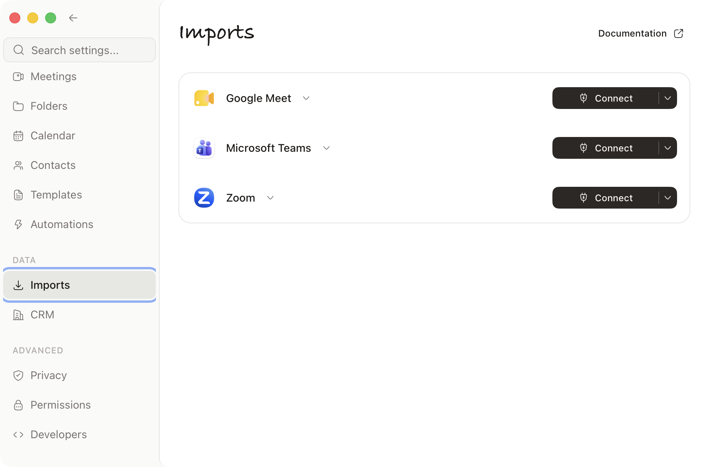

> **Etika dan kebijakan kantor.** Merekam rapat tanpa integrasi tetaplah merekam. Beri tahu peserta di awal rapat, misalnya: "Saya mencatat rapat ini dengan transkripsi lokal di laptop saya." Ikuti aturan kantor soal perekaman. Rekaman dan transkrip tersimpan hanya di Mac ini (`~/Library/Application Support/anarlog/sessions/`).

---

## 3. Gratis setelah trial: apa yang berubah

Akun Anda sedang dalam **trial Pro 7 hari yang berakhir 10 November 2026**. Selama tidak ada metode pembayaran, akun otomatis kembali ke paket **Free ($0)** setelah trial selesai.

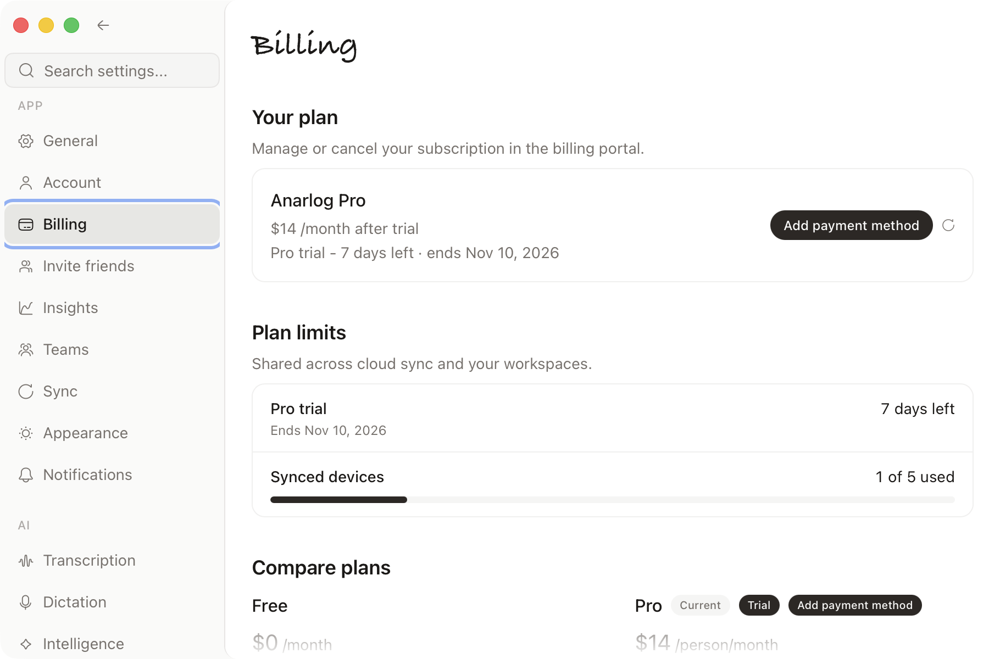

**Jangan klik "Add payment method".**

| Fitur | Selama trial | Setelah trial (Free) |
|---|---|---|
| Merekam mic + system audio | Bisa | Bisa |
| Transkripsi lokal Whisper (sudah disetel) | Bisa | Bisa, tanpa batas |
| Ringkasan & tanya-jawab AI | Claude di Cursor (MCP) | Claude di Cursor (MCP) |
| Catatan cerdas, pembicara, kamus, dikte (Notesy) | Bisa | Bisa |
| Ringkasan otomatis bawaan Anarlog | Anarlog Cloud | Tidak ada; diganti Claude di Cursor |

**Satu catatan penting tentang masa trial.** Halaman **Settings → Intelligence** di versi ini hanya menawarkan pilihan "Anarlog / Pro (Cloud)" sampai Anda memasang model AI lokal. Akibatnya, sampai 10 November, setiap kali rekaman selesai Anarlog otomatis mengirim **teks transkrip** (bukan audio) ke Anarlog Cloud untuk membuat tab *Summary*. Audio tetap tidak keluar dari Mac karena transkripsinya lokal.

Setelah 10 November, ringkasan cloud itu berhenti dengan sendirinya. Mulai saat itu, ringkasan dibuat oleh **Claude di Cursor** (lihat [bagian 10](#10-claude-di-cursor-sebagai-ai-anarlog)). Untuk rapat yang sangat sensitif, sebaiknya jangan rekam dengan Anarlog sebelum 11 November.

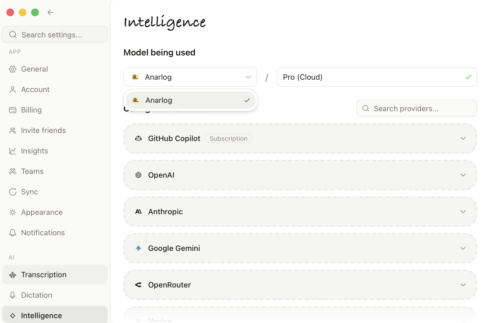

---

## 4. Pengaturan yang sudah disetel, per halaman

Buka pengaturan dengan **⌘ ,** (Command + koma) atau lewat menu Anarlog → Settings.

### 4.1 Transcription (transkripsi lokal)

Opsi bawaan **Anarlog / Pro (Cloud)** mengirim audio ke cloud dan hanya tersedia selama Pro. Opsi itu sudah diganti.

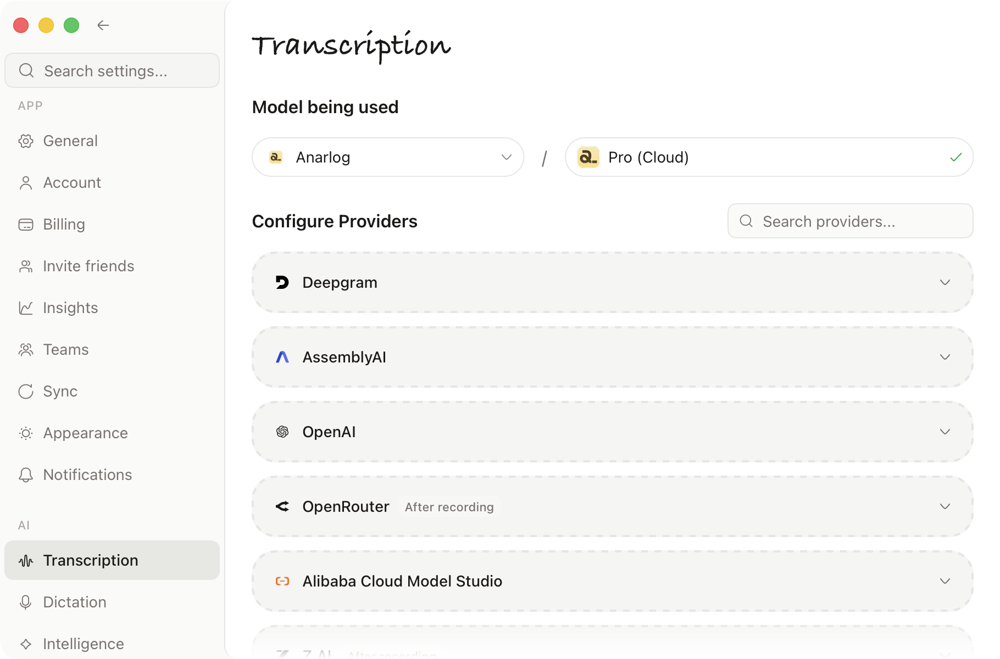

Langkah yang sudah dilakukan (ulangi kalau suatu saat setelan ini ter-reset):

1. Klik dropdown pertama di bawah **Model being used**.

   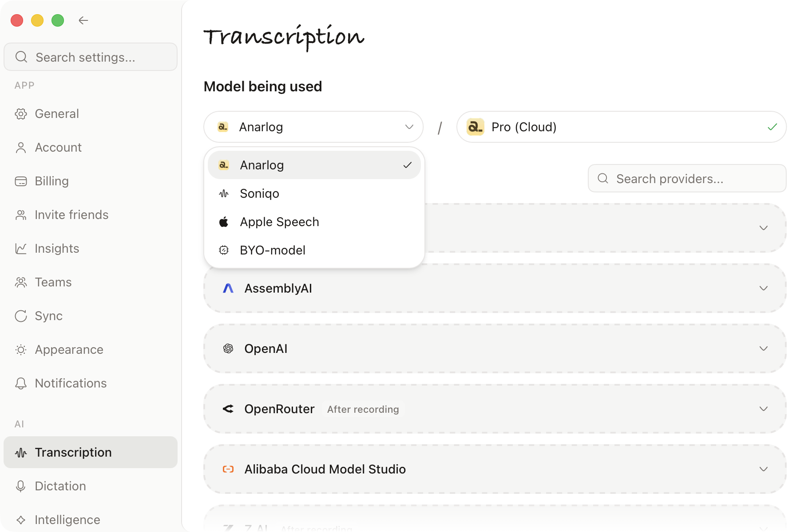

2. Jangan pilih **Soniqo** (Parakeet) atau **Apple Speech**. Keduanya **tidak mendukung bahasa Indonesia**: Parakeet hanya untuk 25 bahasa Eropa, dan Apple Speech untuk 10 bahasa tertentu.

   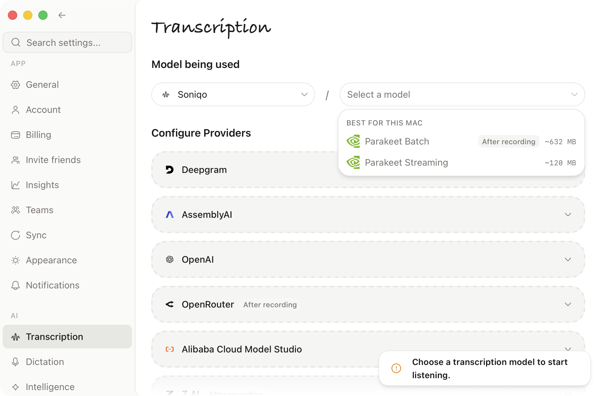

3. Pilih **BYO-model**, lalu klik **Choose a .bin model**.

   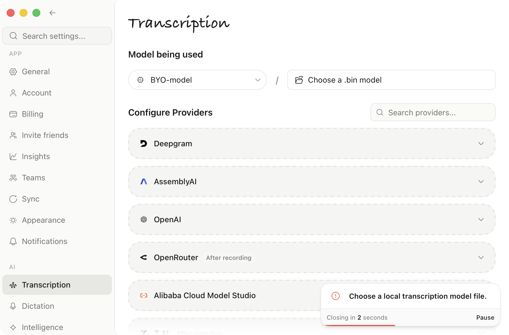

4. Di jendela file, tekan **⌘ ⇧ G** lalu ketik:

   ```
   ~/.notesy/models/whisper-ggml/ggml-large-v3-turbo-q8_0.bin
   ```

   Tekan **Return**, lalu klik **Open**.

   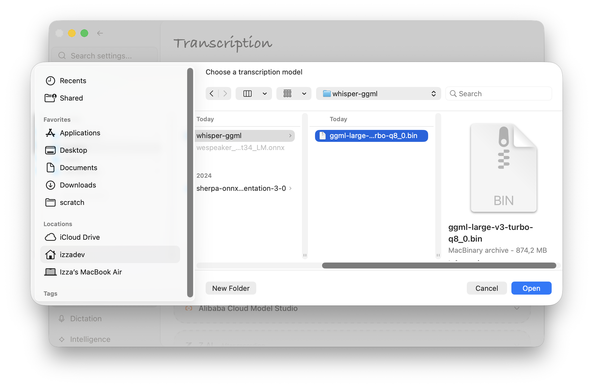

5. Tunggu sampai muncul tanda centang hijau dan tulisan **834 MB · GGML · After recording**.

   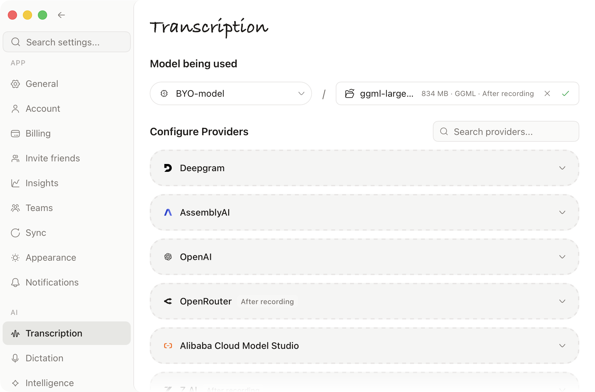

*After recording* berarti teks transkrip muncul **setelah** Anda klik *Stop*, bukan secara live. Untuk rapat 1 jam, proses ini biasanya selesai dalam beberapa menit.

### 4.2 General (bahasa)

**Main language: English**, dan **Additional spoken languages: Indonesian**. Dengan setelan ini, Whisper siap menangani rapat yang berpindah-pindah antara bahasa Indonesia dan Inggris.

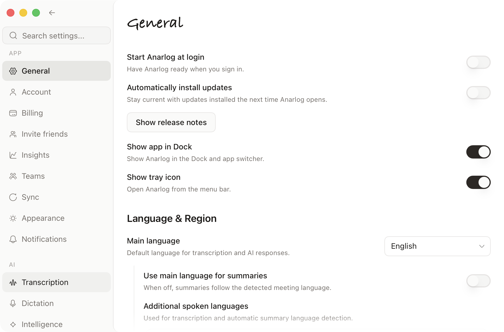

### 4.3 Sync (dimatikan)

**Cloud sync** dimatikan, sehingga catatan rapat tidak diunggah ke server Anarlog. Statusnya harus tertulis **Sync paused**.

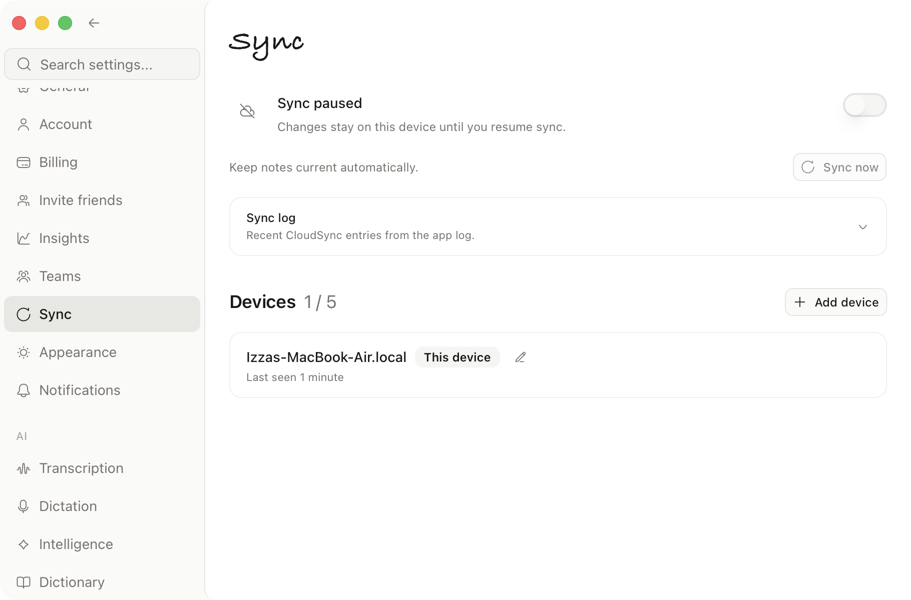

### 4.4 Privacy (dimatikan)

**Share usage data** dan **Error** (laporan crash) dimatikan. **Lock app** bisa Anda nyalakan kalau ingin Anarlog meminta Touch ID saat dibuka.

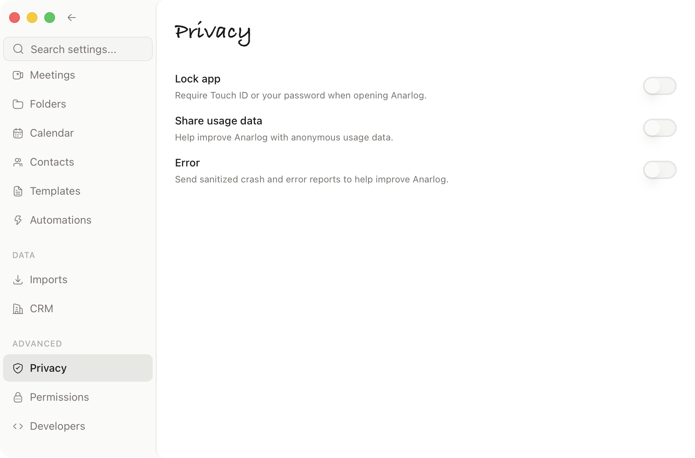

### 4.5 Meetings

- **Join scheduled meetings: mati.** Anarlog tidak akan membuka link rapat sendiri.
- **Default sharing: Only me.**
- **Stop when meeting ends: nyala.** Rekaman berhenti otomatis saat panggilan Zoom/Teams selesai.
- **Start when meeting begins** membutuhkan kalender yang terhubung. Karena kalender sengaja tidak dihubungkan, Anda memulai rekaman secara manual.
- **Capture shared screens** dan **Capture meeting chat** dibiarkan mati.

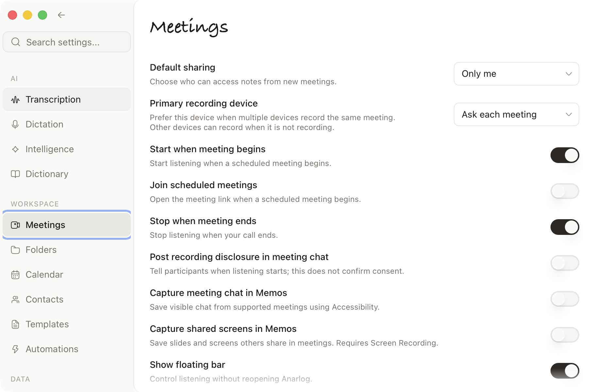

### 4.6 Permissions

**Microphone**, **System audio**, dan **Accessibility** sudah bercentang hijau. **Calendar** sengaja dibiarkan merah (tidak dihubungkan).

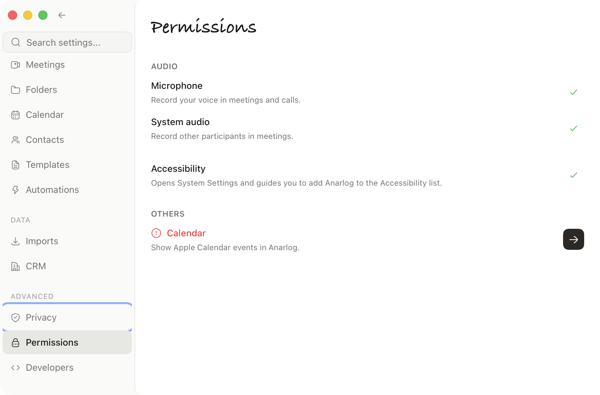

### 4.7 Dictation (dikte Anarlog dimatikan)

Dikte bawaan Anarlog membutuhkan paket Pro, dan shortcut-nya **⌃⌥Space** bentrok dengan dikte Notesy. Karena itu **Enable dictation** dibiarkan **mati**. Gunakan dikte Notesy (lihat [bagian 9](#9-dikte-satu-tombol-di-semua-aplikasi)).

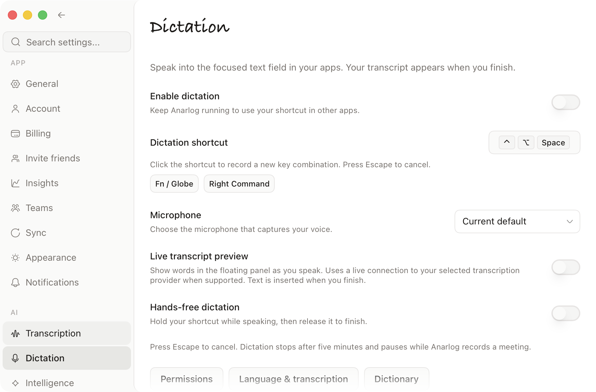

---

## 5. Merekam rapat, per klik

1. **Buka Anarlog** dari Dock atau ikon menu bar.
2. **Gabung ke rapat seperti biasa** di aplikasi Teams atau Zoom, atau di browser, memakai akun kerja Anda. Anarlog tidak menyentuh aplikasi rapat.
3. Di Anarlog, klik **Start Recording**, atau tekan **⌘ ⇧ N**.

   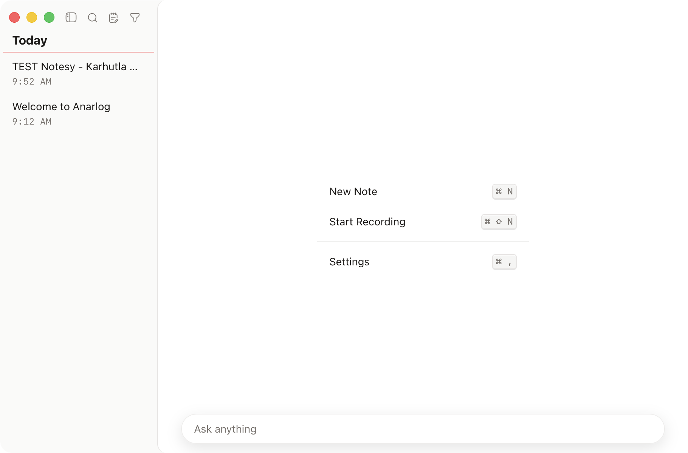

4. Kalau macOS menanyakan izin mikrofon atau audio sistem, klik **Allow**. Izin ini hanya ditanyakan sekali.
5. Selama rapat, sebuah **floating bar** kecil muncul untuk menghentikan atau menjeda rekaman tanpa membuka Anarlog. Anda juga bisa mengetik catatan sendiri di tab **Memos**.
6. Setelah rapat selesai, klik **Stop listening**. Langkah ini otomatis kalau Anda menutup panggilan Zoom/Teams.
7. Tunggu transkrip selesai diproses. Hasilnya muncul di tab **Transcript** beserta pemutar audio.

   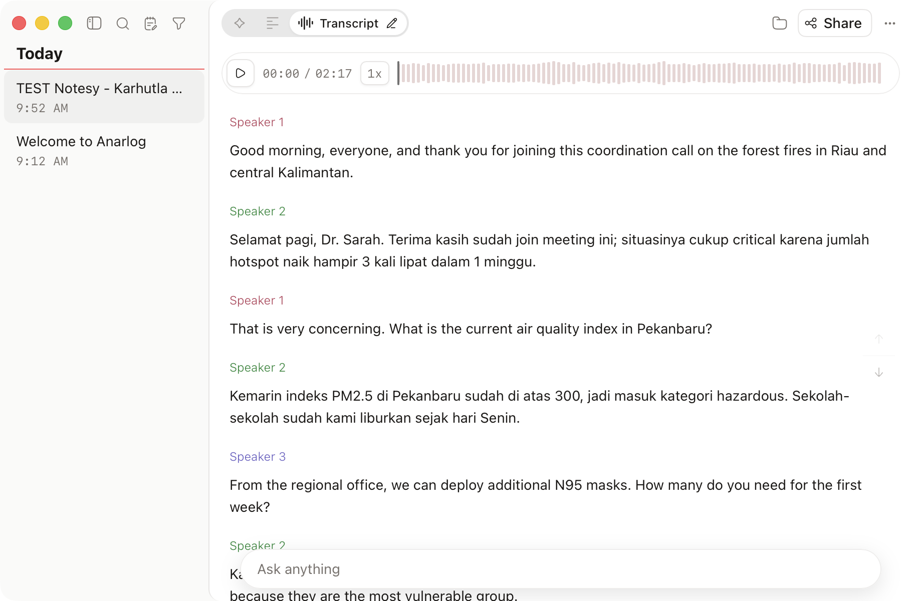

8. Lanjutkan ke [bagian 6](#6-membuat-catatan-cerdas-dengan-notesy) untuk membuat catatan cerdas.

Tips kualitas suara:

- Memakai headphone membuat suara Anda (mic) dan suara peserta lain (system audio) tidak tercampur, sehingga pemisahan pembicara lebih akurat.
- Kalau Anda memakai speaker, rekaman tetap berjalan, tapi suara peserta lain juga ikut tertangkap mic.

---

## 6. Membuat catatan cerdas dengan Notesy

Notesy membaca rekaman Anarlog lalu membuat catatan yang memisahkan **tugas** (lengkap dengan penanggung jawab dan tenggat), **keputusan**, **pertanyaan beserta siapa yang menjawab**, statistik pembicara, singkatan, dan transkrip per pembicara. Semuanya berjalan di Mac tanpa batas durasi.

Buka aplikasi **Terminal** (⌘ Space, ketik "Terminal", lalu Return), kemudian:

1. **Lihat daftar rapat dan salin ID-nya.**

   ```bash
   notesy meetings
   ```

2. **Proses rapat, lalu kirim hasilnya ke Anarlog.**

   ```bash
   notesy process --meeting <ID-RAPAT> --propose
   ```

   Opsi tambahan:
   - `--speakers 4` kalau jumlah pembicara sudah Anda ketahui (hasilnya lebih akurat).
   - `--language id` kalau sebagian besar rapat berbahasa Indonesia.
   - `--open` untuk langsung membuka file catatan.

3. Di Anarlog, buka rapat tersebut. Di bagian atas akan muncul **"1 pending edit"**. Klik **Review memo**.

   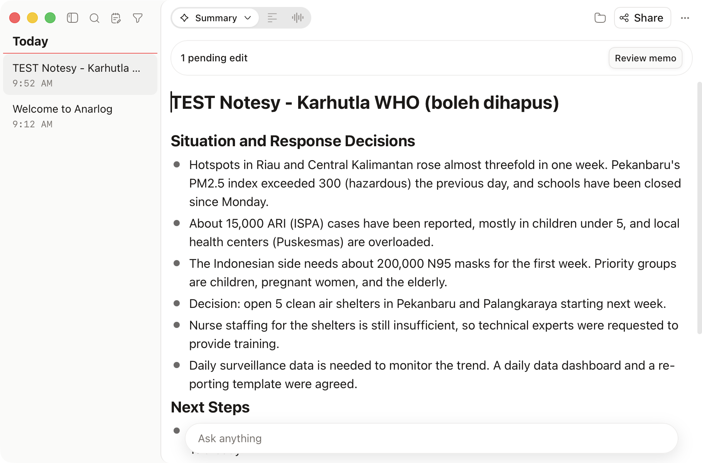

4. Periksa isi catatan, lalu klik **Apply to memo**. Kalau tidak jadi, klik **Decline**.

   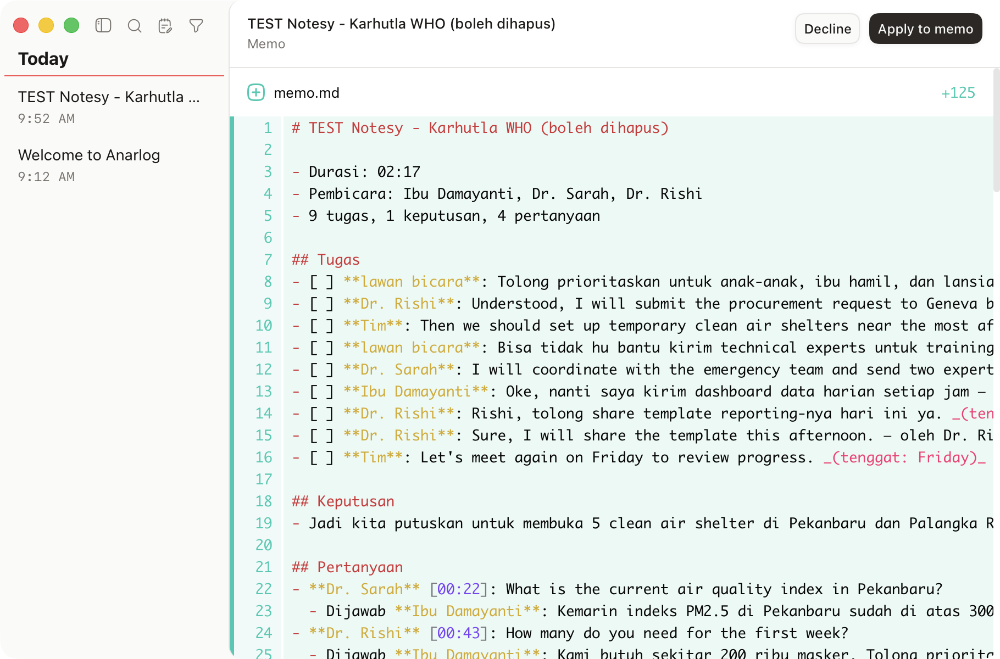

5. Catatan sekarang ada di tab **Memos**. Kotak tugasnya bisa dicentang.

   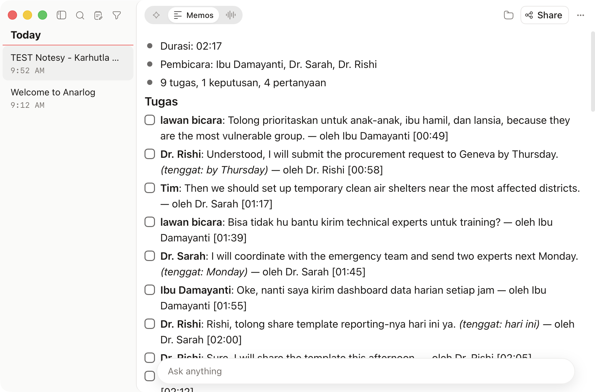

Notesy juga menyimpan salinan catatannya di `~/.notesy/notes/`, dalam bentuk file `.md` (bisa dibaca) dan `.json` (data lengkap).

Notesy juga bisa memproses file audio lain, misalnya rekaman dari HP:

```bash
notesy process ~/Downloads/rekaman.m4a --title "Rapat Koordinasi" --open
```

---

## 7. Mengenali pembicara secara otomatis

Secara bawaan, peserta diberi label *Pembicara 1*, *Pembicara 2*, dan seterusnya. Ada dua cara agar nama mereka langsung dikenali:

**Cara A: beri nama setelah rapat (paling mudah).** Notesy akan mempelajari suara orang itu.

```bash
notesy name ~/.notesy/notes/<file>.json "Pembicara 2" "Ibu Damayanti"
```

Untuk rapat berikutnya, Ibu Damayanti otomatis dikenali.

**Cara B: daftarkan suara di awal.** Siapkan rekaman 20–60 detik yang hanya berisi suara orang tersebut.

```bash
notesy enroll "Dr. Sarah" --file ~/Downloads/sarah.m4a
notesy enroll "Saya" --seconds 20      # rekam langsung dari mic selama 20 detik
```

Melihat atau menghapus suara yang sudah terdaftar:

```bash
notesy speakers
notesy speakers --delete "Dr. Sarah"
```

---

## 8. Kamus custom (glossary)

Fungsinya agar nama orang, singkatan, dan istilah kantor selalu ditulis dengan benar. Kamus offline bahasa Indonesia (46 ribu kata) dan bahasa Inggris (247 ribu kata) sudah terpasang.

```bash
notesy glossary --add "Kemenkes" --alias "kemen kes" --alias "kemenkas"
notesy glossary --add "Dr. Rishi" --person
notesy glossary                      # buka file kamus untuk diedit langsung
```

---

## 9. Dikte satu tombol di semua aplikasi

Tekan **⌃⌥Space** (Control + Option + Space), bicara, lalu tekan **⌃⌥Space** lagi. Teksnya langsung tertempel di aplikasi yang sedang aktif, misalnya Word, Outlook, Teams chat, atau browser. Ikon di menu bar berubah dari **◎** menjadi **● REC** saat merekam, lalu **…** saat memproses.

Dikte Notesy sudah berjalan otomatis saat login, tapi **masih butuh dua izin dari Anda** (sekali saja):

1. Buka **System Settings → Privacy & Security → Accessibility**.
2. Klik **+**, lalu masukkan password atau Touch ID.
3. Tekan **⌘ ⇧ G**, lalu tempel path ini:

   ```
   /Users/izzadev/.local/share/uv/python/cpython-3.12.13-macos-aarch64-none/bin/python3.12
   ```

   Klik **Open**, lalu pastikan sakelarnya **nyala**.
4. Ulangi langkah yang sama di **Privacy & Security → Input Monitoring**.
5. Mulai ulang dikte:

   ```bash
   notesy autostart off && notesy autostart on
   ```

Menu ikon **◎** di menu bar berisi: pilihan bahasa, tempel ulang hasil terakhir, buka kamus, dan muat ulang kamus.

---

## 10. Claude di Cursor sebagai AI Anarlog

Claude, AI di Cursor yang sudah termasuk langganan Cursor Anda, menggantikan fitur AI Pro Anarlog. Claude membaca rapat Anda lewat MCP anarlog, lalu menulis **ringkasan** (tab Summary) dan **memo** langsung ke Anarlog. Tidak ada biaya tambahan dan tidak perlu API key.

**Persiapan (sekali saja):**

1. **Restart Cursor** (keluar dengan ⌘Q, lalu buka lagi).
2. Buka **Cursor Settings → MCP**, lalu pastikan **anarlog** berstatus hijau.
3. Buka folder `Notesy` di Cursor. Aturan di `.cursor/rules/anarlog-ai.mdc` membuat Claude otomatis tahu alur kerjanya.

**Pemakaian sehari-hari:** setelah rapat selesai, ketik di chat Cursor, misalnya:

- "Ringkas rapat terakhir saya."
- "Ringkas rapat Karhutla tadi pagi dan kirim ke Anarlog."
- "Apa saja tugas saya dari semua rapat minggu ini?"
- "Siapa yang setuju membuka shelter, dan kapan tenggatnya?"
- "Buatkan draf email tindak lanjut untuk peserta rapat terakhir."

Claude akan menjalankan Notesy untuk mengenali pembicara dan tugas, membaca transkrip, menulis ringkasan berbahasa Indonesia, lalu mengirimnya sebagai usulan. Di Anarlog, buka rapatnya, klik **Review summary**, periksa perubahannya, lalu klik **Apply to summary**.

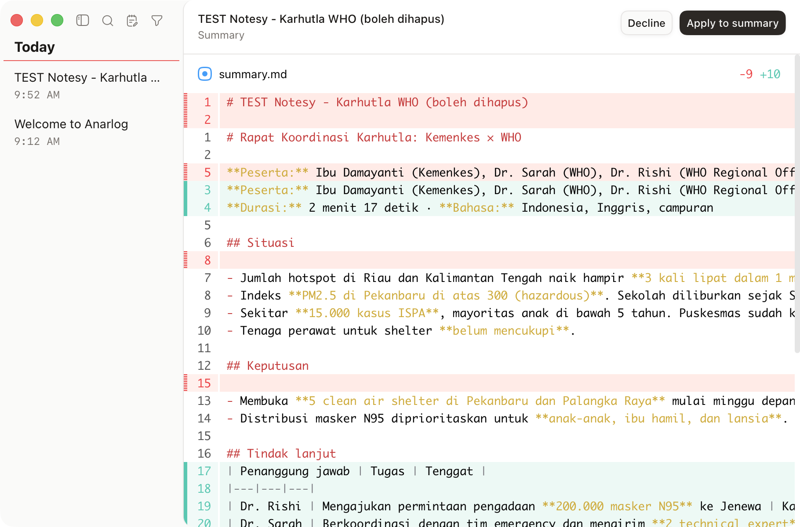

Hasilnya di tab **Summary**:

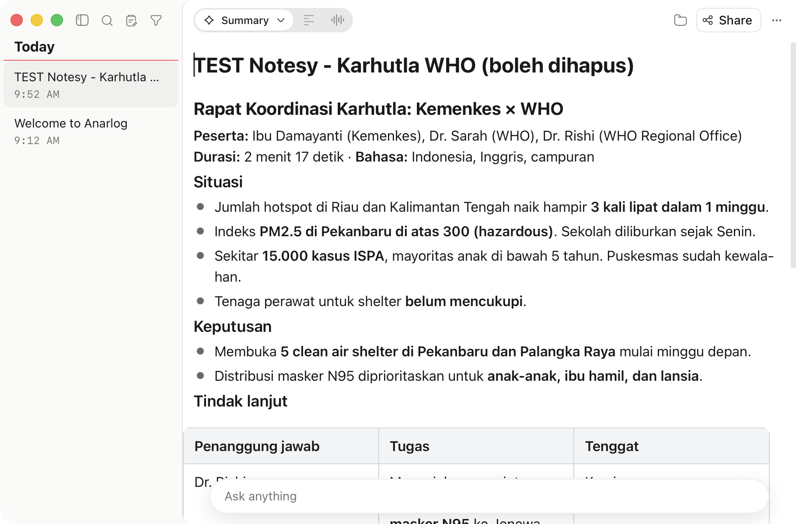

Setiap perubahan dari Claude selalu masuk sebagai **pending edit**. Tidak ada yang berubah sebelum Anda klik *Apply*.

---

## 11. Checklist sebelum rapat sensitif

- [ ] **Settings → Transcription** menunjukkan **BYO-model / ggml-large-v3-turbo…** dengan centang hijau.
- [ ] **Settings → Sync** menunjukkan **Sync paused**.
- [ ] Sebelum 11 Nov 2026, Intelligence bawaan Anarlog masih memakai cloud. Hindari merekam rapat yang sangat sensitif sampai trial berakhir (lihat [bagian 3](#3-gratis-setelah-trial-apa-yang-berubah)).
- [ ] Jangan gunakan **Share** atau **web search** di chat Anarlog untuk rapat sensitif.
- [ ] Peserta sudah diberi tahu bahwa rapat dicatat.

---

## 12. Troubleshooting

| Masalah | Solusi |
|---|---|
| Transkrip kosong atau muncul "Choose a transcription model" | Ulangi [langkah 4.1](#41-transcription-transkripsi-lokal). Pastikan file model masih ada di `~/.notesy/models/whisper-ggml/`. |
| Suara peserta lain tidak terekam | **Settings → Permissions → System audio** harus hijau. Klik tombol panahnya lalu izinkan Anarlog. |
| Rapat yang diimpor lewat CLI tidak muncul di sidebar | Keluar dari Anarlog lewat ikon menu bar → Quit, lalu buka lagi. |
| `notesy: command not found` | Jalankan `~/.local/bin/notesy …`, atau buka Terminal baru. |
| `notesy process --meeting` gagal menemukan rekaman | Pastikan rapat sudah selesai (*Stop listening*). Rekaman ada di `~/Library/Application Support/anarlog/sessions/<ID>/`. |
| ⌃⌥Space tidak bereaksi | Berikan izin Accessibility dan Input Monitoring ([bagian 9](#9-dikte-satu-tombol-di-semua-aplikasi)). Cek log di `~/.notesy/dictate.log`. |
| Nama pembicara salah | `notesy name <file.json> "Pembicara X" "Nama Benar"`. Rapat berikutnya akan lebih akurat. |
| Ada popup trial atau upgrade | Tutup saja. Jangan klik *Add payment method*. |
| Status MCP di Cursor merah | Restart Cursor. Pastikan `~/.local/bin/anarlog mcp` bisa dijalankan dari Terminal. |

Rapat contoh **"TEST Notesy - Karhutla WHO (boleh dihapus)"** di sidebar berisi audio sintetis dari uji coba. Anda boleh menyimpannya sebagai contoh atau menghapusnya.
